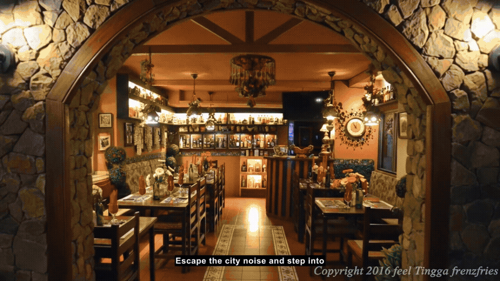

<div align="center">


# Fable Motion: Enterprise Multimodal AI Video Pipeline

**Fault-Tolerant 5-Phase AI Pipeline for Vertical Short-Form Cinema (9:16)**

[](https://www.python.org/)
[](https://fastapi.tiangolo.com)
[](https://docs.pydantic.dev/)
[](https://nextjs.org/)
[](https://cloud.google.com/vertex-ai)
[](#testing--quality-assurance)
[](LICENSE)

[Architecture](#system-architecture) • [Demo](#end-to-end-demo-walkthrough) • [Engineering Highlights](#key-engineering--architectural-highlights) • [Quickstart](#quickstart--local-reproduction) • [Testing](#testing--quality-assurance)

</div>

---

An automated, fault-tolerant enterprise pipeline for vertical short-form cinema (9:16), orchestrating **Google Cloud Vertex AI & Google Gemini** (**Gemini 3.5 Flash-Lite**, **Imagen 3**, and **Veo 3.1 Fast**) with deterministic state recovery, decoupled media adapters, dynamic word-level subtitle synchronization, and full-stack observability.

> [!NOTE]
> **Technical Recruiter & Engineering Hiring Showcase**
> This repository is a curated architectural showcase of **Fable Motion**. While proprietary prompt weights, fine-tuned character DNA datasets, and private SaaS endpoints remain protected under commercial IP, it exposes the **full system architecture, fault-tolerant state machine, decoupled provider adapters, LLMOps observability, testing framework, and Next.js web studio**.

## System Architecture



<sub>Source: <a href="./docs/diagrams/architecture.html">Interactive HTML diagram</a></sub>

## End-to-End Demo Walkthrough

<div align="center">
  <a href="https://youtu.be/KIh25w4ehPQ">
    
  </a>
  <p>
    <em><a href="https://youtu.be/KIh25w4ehPQ"><strong>Watch Demo on YouTube</strong></a> &bull; <a href="https://github.com/jaypiasco/fable-motion-showcase/raw/main/demo/FableMotion_demo.mp4"><strong>Stream Raw MP4</strong></a></em>
  </p>
</div>

| Stage | Engine | What It Delivers |
| :--- | :--- | :--- |
| **Phase 1: Screenplay** | Gemini 3.5 Flash-Lite | 10–14 scene vertical story arc, 3s hook, Foley cues, and dialogue |
| **Phase 2: Character Bibles** | Google Imagen 3 | Immutable character reference sheets and 9:16 reference portraits |
| **Phase 3: Keyframes** | Google Imagen 3 | Consistent scene stills conditioned on Phase 2 portraits |
| **Phase 4: Motion Dynamics** | Google Veo 3.1 Fast | 9:16 cinematic video clips with camera motion and synced audio |
| **Phase 5: Captions & Master** | Faster-Whisper + FFmpeg | Word-level `.ass` karaoke subtitles burned and stitched into `final_story.mp4` |
| **Studio, Publishing & Telemetry** | Next.js, Langfuse, Grafana | Live WebSocket logs, RFC 7233 video streaming, social publishing, and cost/latency tracing |

## Key Engineering & Architectural Highlights

### 1. Fault-Tolerant Distributed State Machine (`core/state_manager.py`)
- **Atomic Checkpointing**: Writes state updates to an isolated temporary file before atomic rename to `./archive/{timestamp}_{story_slug}/pipeline_state.json`.
- **Granular Resumption**: Tracks each phase and individual scene/shot so interrupted runs skip completed work.
- **Graceful `SIGINT` Handling**: Flushes active work and transitions cleanly to `paused` for zero-data-loss resume via `python orchestrator.py resume`.
- **Exponential Backoff with Jitter**: Handles `429 Too Many Requests` and `RESOURCE_EXHAUSTED` from 5s to 300s.

### 2. Decoupled Media Provider Architecture (`services/media/`)
- **Adapter & Factory Patterns**: Abstract base classes (`BaseImageProvider`, `BaseVideoProvider`, `BaseTTSProvider`, `BaseLipsyncProvider`) resolved dynamically by `services/media/registry.py`.
- **Multi-Vendor Routing**: Google Veo 3.1 Fast / Fal AI (video), Google Imagen 3 / Fal Flux.1 (images), Edge TTS / ElevenLabs / gTTS (audio), and Sync Labs / Passthrough (lipsync).

### 3. Schema-Validated Creative Slot Compilation (`prompts/story_archetypes.py`)
- **Pydantic v2 Rigor**: Validates `StoryArchetypeConfig`, `CastMemberArchetype`, `EnvironmentArc`, and `PlotBeat` schemas before dynamic prompt compilation.

### 4. Audio-Visual Post-Processing (`caption_pipeline.py`, `services/video_editor.py`)
- **Word-Level Alignment**: Extracts millisecond timestamps with **Faster-Whisper** and burns stylized `.ass` karaoke subtitles via FFmpeg with timebase re-encoding fallbacks.

### 5. Production Web Studio & Telemetry (`server.py`, `frontend/`, `monitoring/`)
- **RFC 7233 Byte-Range Streaming** (`api/routes_media.py`) for instant video seeking and frame scrubbing.
- **Real-Time WebSocket Console** and **Next.js 15 App Router Studio** with WebGL/WGSL shaders and interactive phase steppers.
- **LLMOps & Metrics**: Langfuse distributed tracing (`services/langfuse_tracer.py`) plus Prometheus & Grafana dashboards (`monitoring/`).

## Design Patterns Implemented

| Pattern | Module | Purpose |
| :--- | :--- | :--- |
| **State** | `core/state_manager.py` | Manages pipeline phases, transitions, and atomic recovery |
| **Adapter** | `services/media/` | Decouples third-party generative media APIs behind uniform interfaces |
| **Factory** | `services/media/registry.py` | Dynamically instantiates media providers from runtime settings |
| **Slot Compilation** | `prompts/story_archetypes.py` | Compiles dynamic archetypes into validated prompt templates |
| **Retry / Backoff** | `core/retry.py` | Exponential backoff with jitter for LLM rate limits (`429`) |
| **Observer** | `server.py` | Real-time WebSocket streaming of server logs to web clients |
| **Queue** | `core/queue.py` | Decouples job submission from background daemon execution |

## Project Organization

```text
fable-motion-showcase/
├── config.py                     # Central runtime settings & AI client config
├── orchestrator.py               # Main CLI and pipeline orchestration engine
├── caption_pipeline.py           # Word-level dynamic subtitle burning
├── server.py                     # FastAPI studio server (REST + WebSocket)
├── ecosystem.config.js           # PM2 daemon configuration
├── pipeline_state_schema.json    # JSON Schema for runtime state validation
├── core/                         # State manager, schema, retry, sanitizer, queue
├── pipeline/                     # Story pipeline coordinator & assembly
├── phases/                       # Phase 1–5 controllers
├── services/                     # Media adapters, Gemini client, Langfuse, FFmpeg, GCS
├── prompts/                      # Creative DNA, archetypes, presets, phase prompts
├── presets/                      # Stylized character presets
├── api/                          # FastAPI routes (stories, media, system, queue)
├── monitoring/                   # Prometheus metrics & Grafana dashboards
├── evals/                        # LLMOps evaluation runner & rubrics
├── tests/                        # Unit & integration test suites
├── docs/diagrams/                # Architecture diagram (HTML + SVG)
├── frontend/                     # Source Next.js 15 Web Studio (TypeScript + Tailwind)
└── demo/                         # Showcase media assets (MP4, GIF, poster)
```

## Testing & Quality Assurance

```bash
pytest tests/unit -v              # Unit tests (archetypes, state, sanitizers, retry)
pytest tests/integration -v       # Integration tests (recovery, registry, FFmpeg)
pytest tests/ -v --cov=.          # Full test suite with coverage
python evals/run_evals.py         # Automated LLMOps evaluation rubrics
```

## Quickstart & Local Reproduction

> [!TIP]
> Set `GEMINI_API_KEYS` in `.env` for live generation, or run the unit/integration test suites locally without external keys.

```bash
git clone https://github.com/jaypiasco/fable-motion-showcase.git
cd fable-motion-showcase

python -m venv .venv
source .venv/bin/activate        # Windows: .venv\Scripts\activate
pip install -r requirements.txt

cp .env.example .env
```

```bash
# Run CLI orchestrator
python orchestrator.py run --prompt "A cyberpunk courier racing through a rain-drenched Neo Tokyo"
python orchestrator.py resume
python orchestrator.py status

# Launch Web Studio Dashboard at http://localhost:8000
python server.py --port 8000
```
